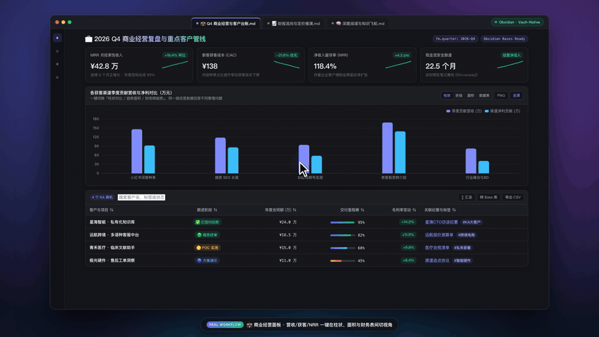
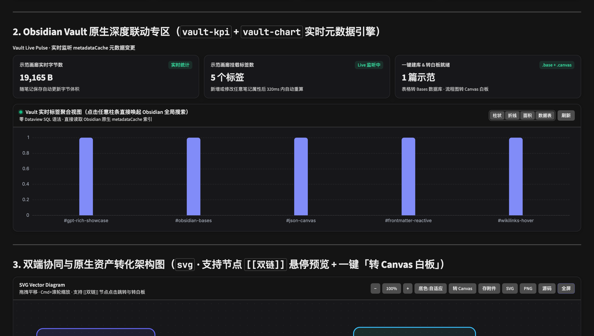
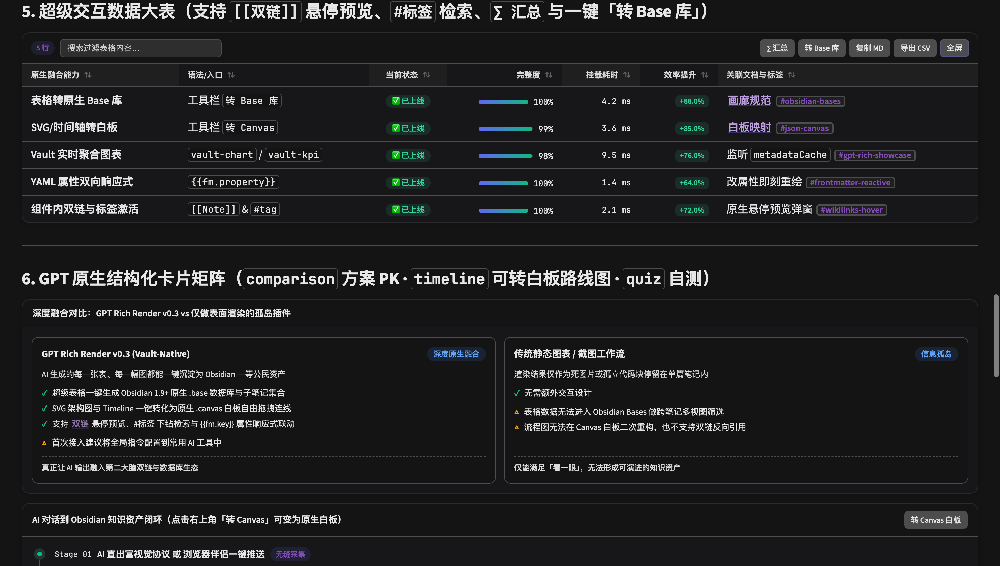
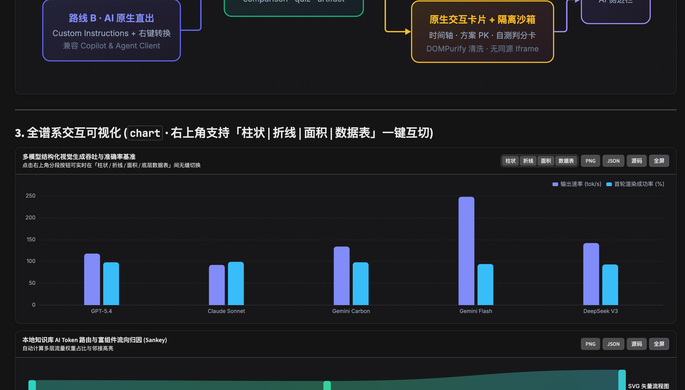
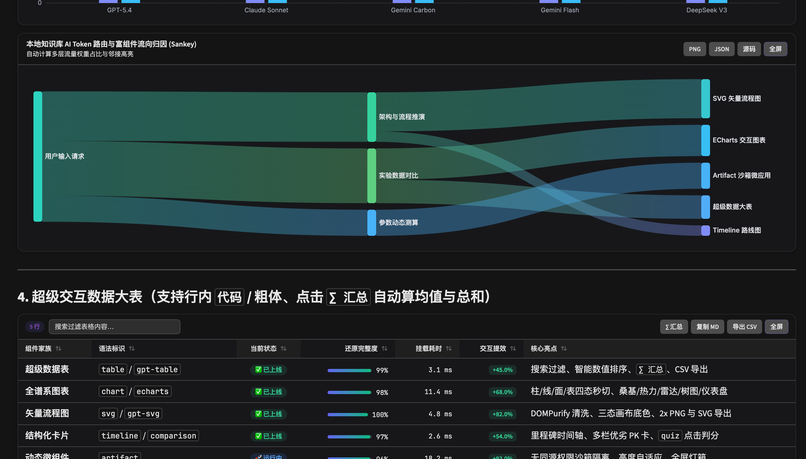
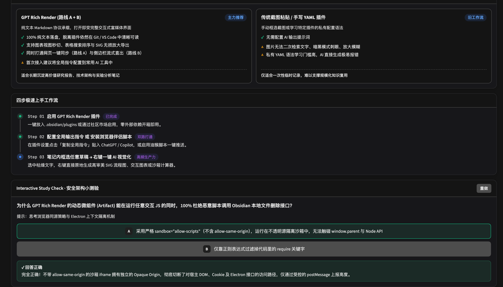

<div align="center">

# ✨ Vivid

**Make AI & Markdown Notes Come Alive — ChatGPT & Claude-grade interactive visual rendering, deeply fused with Obsidian Bases, Canvas, Properties, and Wikilinks.**

[](https://github.com/Yuki-zik/obsidian-vivid/releases)
[](https://github.com/Yuki-zik/obsidian-vivid/actions/workflows/ci.yml)
[](https://obsidian.md)
[](#privacy-permissions--network-disclosure)
[](./tests)
[](./LICENSE)
[](./README_ZH.md)

*Not just recreating web AI charts in Markdown — Vivid bridges AI-generated outputs directly into first-class **Obsidian `.base` databases**, **`.canvas` whiteboards**, **`metadataCache` analytics**, and **live `[[Wikilink]]` knowledge graphs**.*

<br/>



🎬 **[Watch 1080p 60fps Promo Video (`vivid-promo.mp4`)](./docs/assets/vivid-promo.mp4)** · Reproduce locally via `npm run promo`

</div>

---

## Why Vivid?

Most visualization plugins stop at painting isolated diagrams inside a single note. **Vivid** connects rich GPT/Claude UI rendering directly with **five Vault-Native Obsidian integrations**:

| Vault-Native Integration | Problem Solved | Interactive Workflow |
| :--- | :--- | :--- |
| **1. Super-Table → Native `.base` Database** | AI comparison & literature tables get trapped inside one note without cross-note filtering | Click **`转 Base 库`** (`To Base`) on any table to generate typed YAML frontmatter child notes + an Obsidian `.base` file (`Table` & `Cards` views) |
| **2. SVG & Timeline → Native `.canvas` Whiteboard** | Static diagrams cannot be rearranged, annotated, or connected in Canvas | Click **`转 Canvas`** (`To Canvas`) to convert SVG flows or roadmaps into JSON Canvas 1.0 `.canvas` boards — auto-linking `[[Note]]` nodes to real Vault files |
| **3. Zero-SQL Live Vault Analytics (`vault-chart`, `vault-kpi`)** | Complex DataviewJS scripts break or go stale as your vault grows | Reads Obsidian's native `metadataCache` locally to aggregate folders, `#tags`, and YAML Properties (`Bar`, `Pie`, `Sankey`), drilling down into Global Search on click |
| **4. Embedded `[[Wikilinks]]` & `#tags` Inside Visuals** | Links inside generated tables/diagrams are normally dead text | Write `[[Note\|Alias]]` or `#tag` inside tables, timelines, comparison cards, and SVG `<text>` nodes to enable native Page Preview popovers and click-to-open navigation |
| **5. Reactive `{{fm.key}}` Property Binding** | Updating frontmatter metrics forces manual edits in note charts | Interpolates `{{fm.property \| fallback}}` across `kpi`, `chart`, `gpt-table`, and `gpt-ui` blocks (preserving inline code literals) and refreshes on metadata save |

### Live Showcase




---

## Full Interactive Component Suite

### 1. Offline Apache ECharts (`chart`, `gpt-chart`, `echarts`)
Supports `bar`, `horizontalBar`, `line`, `area`, `pie`, `doughnut`, `radar`, `sankey`, `heatmap`, `gauge`, `treemap`, and native ECharts `option` specs — with one-click switching between **Bar | Line | Area | Underlying Data Table**, `2x PNG` export, and lightbox fullscreen zoom.



### 2. Automatic Super-Tables (Standard Markdown Tables & `gpt-table`)
Automatically upgrades Markdown tables in Reading View and AI chat sidebars with instant keyword search, unit/currency-aware numeric sorting, `∑` summary footers (`avg` / `sum`), percentage progress bars, delta pills (`+18.5%` / `-12.0%`), semantic status badges, CSV/Markdown export, and `.base` export.



### 3. Structured Cards, Quizzes & Sandboxed Artifacts (`kpi`, `timeline`, `comparison`, `quiz`, `artifact`)
Includes responsive KPI sparkline cards, vertical roadmaps, side-by-side comparison grids, interactive self-check quizzes, and live HTML/CSS/JS widgets isolated inside opaque-origin `<iframe sandbox="allow-scripts">` containers.



---

## Syntax Quick Reference (100% Local-First Plain Text)

1. **KPI Cards with Reactive Property Binding (`kpi` / `metrics`)**:
   ````markdown
   ```kpi
   [
     { "label": "Stage", "value": "{{fm.stage | v1.0}}", "delta": "+12.8%", "trend": "up", "sparkline": [60, 75, 88, 96] }
   ]
   ```
   ````
2. **Live Vault Metadata Analytics (`vault-chart` / `vault-kpi`)**:
   ````markdown
   ```vault-chart
   { "type": "sankey", "title": "Knowledge Flow: Folder -> Tag", "sourceBy": "folder", "targetBy": "tag", "limit": 12 }
   ```
   ````
3. **Charts (`chart` / `echarts`)**: Standard JSON with `{ type, labels, datasets }` or `{ type, data }` or full ECharts `option`.
4. **Pan-Zoom Sanitized Diagrams (`svg`)**: Standard `<svg>...</svg>` with drag-to-pan, `Cmd/Ctrl + Wheel` zoom, Light/Dark/Auto backdrops, attachment snapshots, `2x PNG` export, and JSON Canvas export.
5. **Sandboxed Micro-Apps (`artifact` / `html-preview`)**: Self-contained HTML/CSS/JS snippets auto-styled with Obsidian theme CSS variables.

---

## Installation & Workflows

### 1. Install in Obsidian
- **Community Plugins**: Install and enable **Vivid** directly from **Settings → Community plugins → Browse** (once approved).
- **Obsidian BRAT**: Open **BRAT** → **Add Beta plugin** → enter `Yuki-zik/obsidian-vivid` → enable **Vivid**.
- **Manual Release Install**: Download `main.js`, `manifest.json`, and `styles.css` from [GitHub Releases](https://github.com/Yuki-zik/obsidian-vivid/releases) into `<YourVault>/.obsidian/plugins/vivid/`.

### 2. Companion Integrations (Optional)
- **Browser Companion (`browser-companion/`)**: Chrome/Edge MV3 extension and Tampermonkey script that add a `Send to Obsidian ✨` button on `chatgpt.com` and `claude.ai` via `obsidian://vivid-import`.
- **AI System Prompt (`GPT-CUSTOM-INSTRUCTIONS.md`)**: Run command **`Copy GPT Rich Instructions`** (`Cmd/Ctrl + P`) and paste into ChatGPT Custom Instructions or Obsidian Copilot / Agent Client so streamed AI responses render live as charts, super-tables, and diagrams.
- **Editor Selection Transform**: Highlight text in the editor, right-click, and convert it into SVG, Chart, Super-Table, or Artifact (uses your configured API key or copies the structured prompt to clipboard in zero-API-key mode).

### 3. Build from Source
```bash
git clone https://github.com/Yuki-zik/obsidian-vivid.git
cd obsidian-vivid
npm install
npm run lint
npm test
npm run build
```
Open [examples/Vivid-Showcase.md](./examples/Vivid-Showcase.md) inside Obsidian to test every block type.

---

## Privacy, Permissions & Network Disclosure

1. **100% Offline Core & Local-First Storage**: Apache ECharts and `DOMPurify` are bundled directly inside `main.js`. There are zero external CDN loads, zero telemetry, and zero analytics. Your notes stay plain-text Markdown, standard SVG, and standard JSON.
2. **Vault Enumeration & Vault Write**: Used locally on user notes solely to power `vault-chart` / `vault-kpi` live metadata aggregation (`app.vault.getMarkdownFiles()` + `metadataCache`) and user-triggered exports (`.base`, `.canvas`, `.svg` snapshots, or browser imports via `app.vault.create`).
3. **Clipboard Access**: Invoked only when you click copy buttons (`Copy MD`, `JSON`, `Copy HTML`, `Copy SVG Source`, or `Copy Prompt`) or explicitly invoke the `import-gpt-clipboard-as-note` command.
4. **Optional External AI Endpoint**: Network requests (via Obsidian's `requestUrl`) occur **only** if you manually enter your own OpenAI-compatible API Base URL & API Key in plugin settings and trigger an editor right-click visual transform command.
5. **Security Hardening**: Every SVG passes strict `DOMPurify` sanitization and `DOMParser` mounting (no `innerHTML`), and every HTML artifact executes inside `<iframe sandbox="allow-scripts" referrerpolicy="no-referrer">` without `allow-same-origin`.

---

## License

Released under the [MIT License](./LICENSE).
