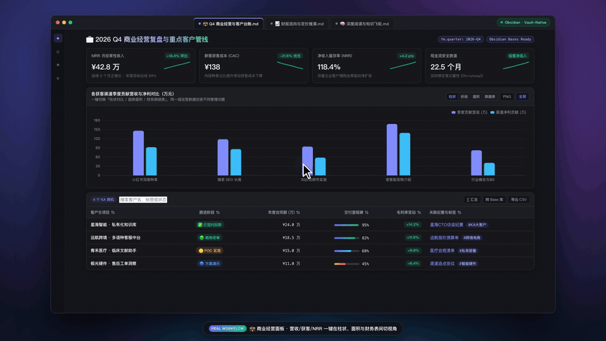
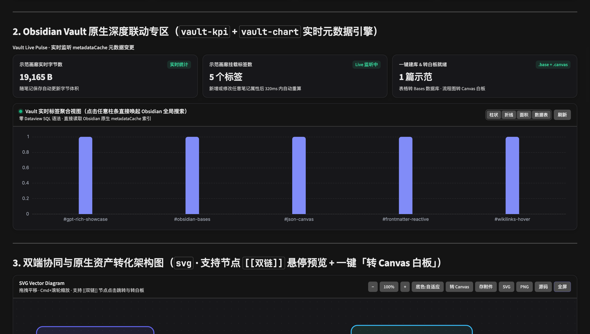
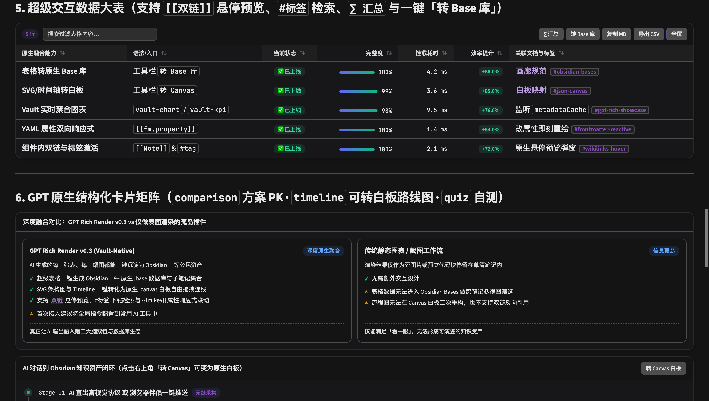

<div align="center">

# ✨ Vivid

**Make AI & Markdown Notes Come Alive — ChatGPT & Claude-grade interactive visual rendering, deeply fused with Obsidian Bases, Canvas, Properties, and Wikilinks.**

[](https://github.com/Yuki-zik/obsidian-vivid/releases)
[](https://github.com/Yuki-zik/obsidian-vivid/actions/workflows/ci.yml)
[](https://obsidian.md)
[](./tests)
[](./LICENSE)
[](./README.md)

<br/>



🎬 **[Watch 1080p 60fps Promo Video (`vivid-promo.mp4`)](./docs/assets/vivid-promo.mp4)** · Reproduce locally via `pnpm run promo`

</div>

---

## Why Vivid?

Most visualization plugins stop at painting isolated charts inside a single note. **Vivid v0.3** combines **1:1 GPT/Claude rich UI fidelity** with **first-class Obsidian Vault-Native integration**:

1. **One-Click Super-Table → Native Obsidian `.base` Database**: Turn any AI-generated comparison table into structured Frontmatter notes + an Obsidian 1.9+ `.base` database (`Table` + `Cards` views) with a single click.
2. **One-Click SVG & Timeline → Native `.canvas` Whiteboard**: Convert vector architecture diagrams and roadmaps into editable JSON Canvas 1.0 `.canvas` boards — automatically mapping `[[Note]]` nodes to real Vault file cards!
3. **Zero-SQL Live Vault Analytics (`vault-chart` & `vault-kpi`)**: Aggregate live `metadataCache` folders, tags, and YAML Properties into interactive Bar/Pie/Sankey charts that auto-refresh on save and drill down into Obsidian Global Search on click.
4. **Live `[[Wikilinks]]` Hover Previews, `#tags` & `{{fm.key}}` Reactive Binding**: Native Page Preview popovers inside tables, timelines, comparisons, and even SVG `<text>` nodes, plus live YAML Property interpolation (`{{fm.target | fallback}}`).
5. **Full Offline Rich Suite**:
   - **Super-Tables**: Search, unit-aware sorting, `∑` summary footer (`avg`/`sum`), gradient progress bars, delta pills, semantic badges, CSV/MD export.
   - **Offline ECharts (`chart`)**: Bar, Line, Area, Pie, Doughnut, Radar, Sankey, Heatmap, Gauge, Treemap + instant `Bar | Line | Area | Table` view switching.
   - **Hardened Pan-Zoom SVGs (`svg`)**: `DOMPurify` sanitization, drag-to-pan, wheel zoom, `Auto / Light / Dark` backdrops, Vault attachment snapshot & `2x PNG` export.
   - **Structured Cards & Opaque-Origin Artifacts (`kpi`, `timeline`, `comparison`, `quiz`, `artifact`)**: Isolated inside `<iframe sandbox="allow-scripts">` (never `allow-same-origin`).





---

## Installation & Quick Start

1. **Via Obsidian BRAT (Recommended)**: Open **BRAT** → **Add Beta plugin** → enter `Yuki-zik/obsidian-vivid` → enable **Vivid**.
2. **Manual Release Download**: Download `main.js`, `manifest.json`, and `styles.css` from [GitHub Releases](https://github.com/Yuki-zik/obsidian-vivid/releases) into `<YourVault>/.obsidian/plugins/vivid/`.
3. **Build from Source & Sync Local Vaults**:
   ```bash
   git clone https://github.com/Yuki-zik/obsidian-vivid.git
   cd obsidian-vivid
   pnpm install
   pnpm test        # 35/35 unit & security tests
   pnpm run sync    # Typecheck, bundle & sync to local Obsidian vaults
   ```
   Open [examples/Vivid-Showcase.md](./examples/Vivid-Showcase.md) inside Obsidian to explore every interactive block.

Also includes:
- **Route A Browser Companion** (`browser-companion/`): Chrome/Edge MV3 extension + Tampermonkey userscript injecting **`Send to Obsidian ✨`** into ChatGPT & Claude web UIs.
- **Route B Custom Instructions** ([GPT-CUSTOM-INSTRUCTIONS.md](./GPT-CUSTOM-INSTRUCTIONS.md)) + Editor right-click AI Visual Transformer.

## License

Released under the [MIT License](./LICENSE).
