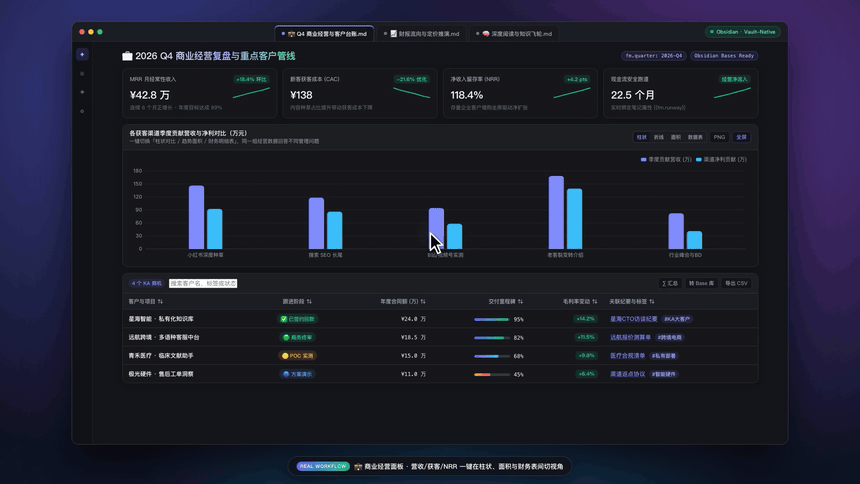
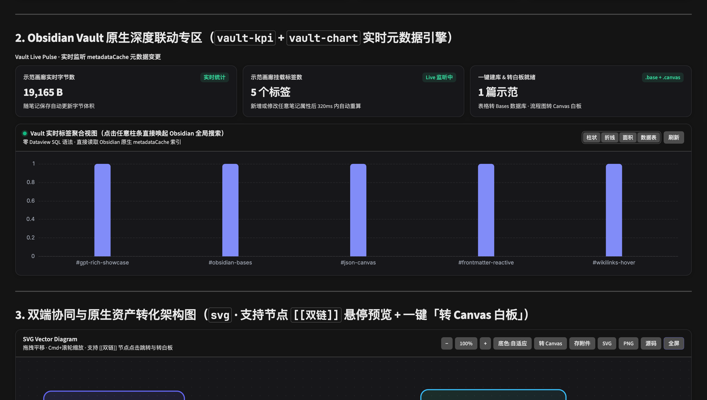
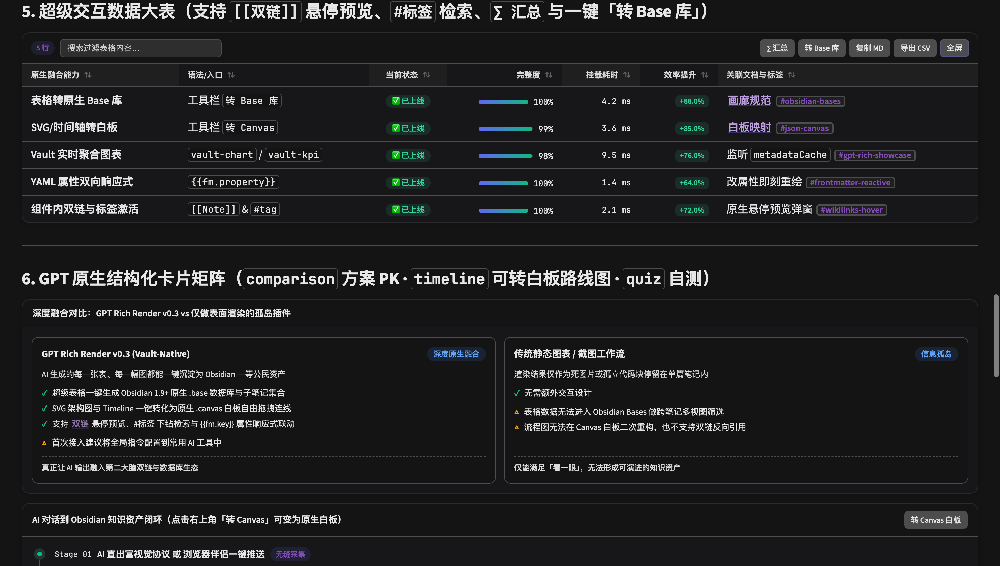
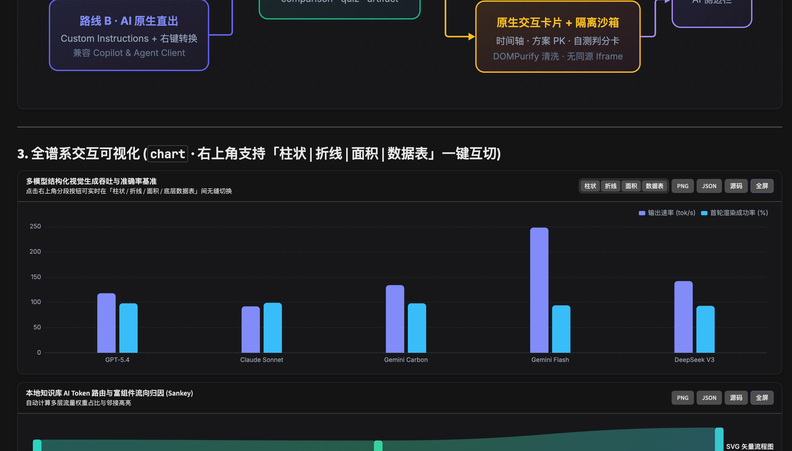
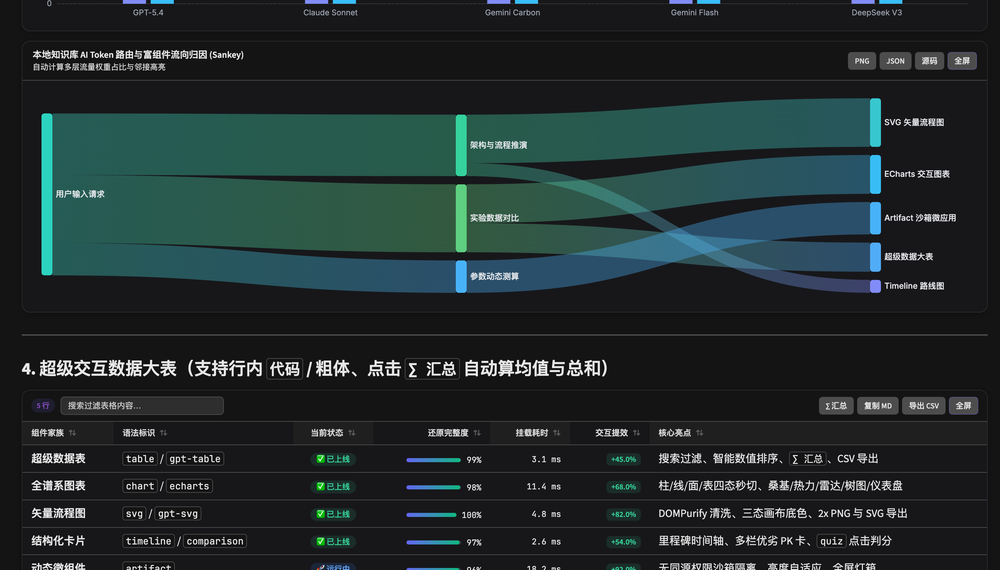
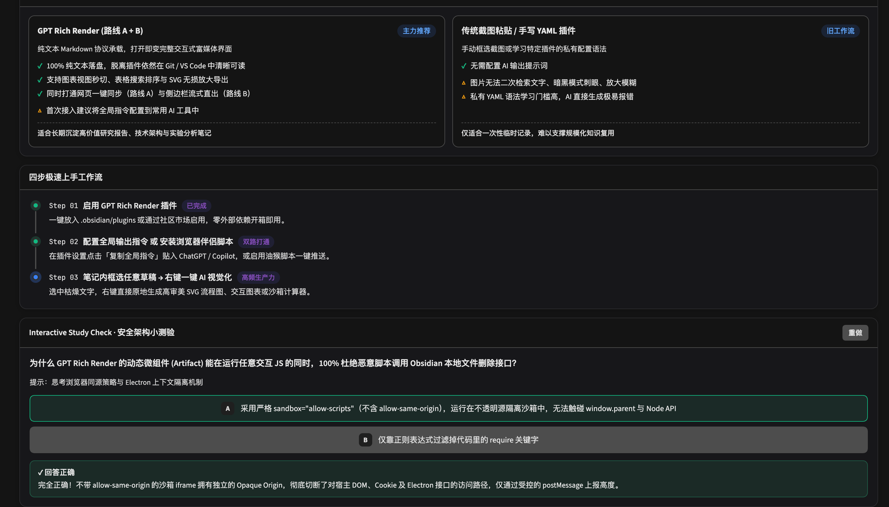

<div align="center">

# ✨ Vivid

**让 AI 与 Markdown 笔记鲜活起来 —— 把 ChatGPT & Claude 级富视觉交互搬进 Obsidian，并与原生 Bases 数据库、Canvas 白板、双链网络深度合一**

[](https://github.com/Yuki-zik/obsidian-vivid/releases)
[](https://github.com/Yuki-zik/obsidian-vivid/actions/workflows/ci.yml)
[](https://obsidian.md)
[](#安全与本地优先架构)
[](./tests)
[](./LICENSE)
[](./README.md)

*不只是复刻网页端 AI 的视觉体验——更能把 AI 生成的每一张超级表格一键沉淀为 **Obsidian 原生 `.base` 数据库**，把每一幅 SVG 流程图与时间轴一键转化为 **原生 `.canvas` 无限白板**，让富交互组件真正长在你的第二大脑双链图谱里。*

<br/>



🎬 **[查看 1080p 60fps 高清完整宣传片 (`vivid-promo.mp4`)](./docs/assets/vivid-promo.mp4)** · 本地可复现命令：`npm run promo`

</div>

---

## 🔥 核心壁垒：不止 1:1 复刻 GPT，更与 Obsidian 原生生态深度融合

市面上大多数渲染插件只做到了「把代码画成一张孤立的图」，数据依然被困在单篇笔记里。**Vivid** 打通了从 **「AI 富视觉表达」→「Obsidian 一等公民知识资产」** 的五大原生桥接：

| 原生融合能力 | 解决什么核心痛点？ | 一键交互体验 |
| :--- | :--- | :--- |
| **1. 超级表格 → 原生 `.base` 数据库** | AI 整理好的竞品对比表、文献阅读表只能干看，没法跨笔记多视图筛选 | 点击表格右上角 **`转 Base 库`**，自动将每行拆分为带类型化 YAML 属性的子笔记，并生成含「全量表格 + 卡片画廊」双视图的 Obsidian 1.9+ 原生 `.base` 数据库 |
| **2. SVG 架构图 / 时间轴 → 原生 `.canvas` 白板** | AI 画出的架构图想手动拖拽排布、补充自己的批注卡片却改不动 | 点击工具栏 **`转 Canvas`**，按 JSON Canvas 1.0 官方规范无损保留几何位置、配色与箭头连线；含 `[[笔记名]]` 的节点自动映射为真实 Vault 文件卡片 |
| **3. `vault-chart` & `vault-kpi` 实时库内聚合** | DataviewJS 门槛高、手写图表数据静态过期 | 零 SQL 直接读取 Obsidian 原生 `metadataCache`：实时统计目录、标签与任意 YAML 属性（支持柱状/饼图/桑基流向图），**点击任意图元直接唤起 Obsidian 全局搜索下钻** |
| **4. 全组件 `[[双向链接]]` 悬停预览 & `#标签` 穿透** | 普通 HTML/SVG 组件里的双链全是死文本，断开了知识图谱连接 | 在超级表格、对比卡、时间轴乃至 **SVG 矢量图 `<text>` 节点**中写 `[[笔记|别名]]`，直接触发 Obsidian 原生 **Page Preview 悬停小窗**与点击跳转；点 `#标签` 秒开全局检索 |
| **5. `{{fm.key}}` 笔记属性双向响应式绑定** | 改了笔记顶部的项目进度或实验指标，正文里的仪表盘还要手动改一遍 | 所有图表、KPI、表格原生支持 `{{fm.属性名 \| 默认值}}` 插值（自动保护行内代码字面量），修改顶部 YAML Properties 瞬间触发组件免刷新重绘 |

### 实机渲染：Vault 实时元数据引擎 (`vault-kpi` + `vault-chart`) 与原生资产一键转化




---

## 🖼️ GPT 原生富交互组件全景画廊

### 1. 全谱系离线 ECharts 图表（右上角支持「柱状 | 折线 | 面积 | 数据表」四态秒切 + 桑基流向图）


### 2. 超级交互数据大表（无感增强普通 Markdown 表格：搜索、智能数值排序、渐变进度条、`∑ 汇总`、CSV 导出）


### 3. 结构化卡片矩阵 & 隔离沙箱微应用（双栏优劣 PK 卡 · 时间轴 · 点击判分自测卡 · 动态调参计算器）


---

## 🚀 四大无缝工作流（网页端 & 库内 AI 全覆盖）

### 工作流 A：浏览器「一键无损推送」伴侣（网页端 ChatGPT / Claude 党首选）
仓库内置开箱即用的 **[Chrome / Edge MV3 扩展](./browser-companion/chrome-extension)** 与 **[Tampermonkey 油猴脚本](./browser-companion/chatgpt-to-obsidian.user.js)**：
1. 自动在 `chatgpt.com` / `claude.ai` 每条回答右下角注入 **`Send to Obsidian ✨`** 胶囊按钮；
2. 点击即可将整条回答中的**富表格、内联 SVG 矢量图、图表数据与代码块**无损提取，通过 `obsidian://vivid-import` 协议毫秒级落盘至你的 Obsidian 库并自动打开预览。

### 工作流 B：1 段全局指令 · AI 侧边栏原生流式直出（Copilot / Agent Client 绝配）
1. 在 Obsidian 按 `Cmd/Ctrl + P` 执行 **`Vivid: 复制 GPT 富渲染全局指令`**（或查看 [GPT-CUSTOM-INSTRUCTIONS.md](./GPT-CUSTOM-INSTRUCTIONS.md)）；
2. 粘贴至 **ChatGPT Custom Instructions** 或 **Obsidian Copilot / Agent Client 的 System Prompt**；
3. 挂载于 Obsidian 官方 `MarkdownRenderer` 底层并内置**流式半截 JSON/SVG 容错骨架屏**——AI 在聊天侧边栏一边吐字，图表和卡片就一边平滑成型！

### 工作流 C：笔记内「框选草稿 → 右键一键 AI 视觉化」
在编辑区框选任意一段文字逻辑或杂乱数据，右键直接原地生成：
- `✨ GPT 视觉化：转为高审美 SVG 架构流程图`
- `📊 GPT 视觉化：转为交互式统计图表 (Chart)`
- `📋 GPT 视觉化：提炼为 KPI + 超级对比表`
- `⚡ GPT 视觉化：生成动态沙箱微工具 (Artifact)`

> 兼容任意 OpenAI 格式接口（OpenAI / DeepSeek / Claude 网关 / 本地 Ollama）；**零 API Key 模式下**点击右键会自动将组装好的转换 Prompt 复制到剪贴板，一键贴给侧边栏 AI 即可。

### 工作流 D：一键插入当前 Vault 实时知识流向大屏
按 `Cmd/Ctrl + P` 执行 **`Vivid: 插入当前 Vault 实时知识流向面板 (Vault Live Dashboard)`**，立即在当前笔记生成实时扫描全库目录分布与目录→标签桑基流向的动态仪表盘。

---

## 📦 极速安装

### 方式一：Obsidian BRAT 一键安装（最省心）
1. 在 Obsidian 安装并打开社区插件 **BRAT (Beta Reviewers Auto-update Tester)**；
2. 点击 **`Add Beta plugin`**，输入仓库地址：`Yuki-zik/obsidian-vivid`；
3. 在 **设置 → 第三方插件** 中开启 **Vivid** 即可自动接收更新。

### 方式二：手动下载 Release 产物
从 **[GitHub Releases](https://github.com/Yuki-zik/obsidian-vivid/releases)** 下载最新版本的 `main.js`、`manifest.json`、`styles.css`，放入 `<你的知识库>/.obsidian/plugins/vivid/` 目录，重载并启用插件即可。

### 方式三：源码编译并一键同步至本机所有 Obsidian Vault
```bash
git clone https://github.com/Yuki-zik/obsidian-vivid.git
cd obsidian-vivid
npm install
npm test        # 运行全部 35 项单元与安全沙箱测试
npm run sync    # 自动编译打包并同步至本机已注册的所有 Obsidian 仓库！
```
随后在 Obsidian **设置 → 第三方插件** 中启用 **Vivid** 即可（推荐打开随附的 [examples/Vivid-Showcase.md](./examples/Vivid-Showcase.md) 体验全部实机交互）。

---

## 📖 语法速查手册（纯文本 Local-First 标准协议）

1. **核心指标看板 (`kpi`) & 笔记属性绑定 (`{{fm.key}}`)**
   ````markdown
   ```kpi
   [
     { "label": "项目阶段", "value": "{{fm.stage | v1.0}}", "delta": "+12.8%", "trend": "up", "sparkline": [60, 75, 88, 96] }
   ]
   ```
   ````
2. **Vault 知识库实时聚合 (`vault-kpi` & `vault-chart`)**
   ````markdown
   ```vault-chart
   { "type": "sankey", "title": "知识拓扑流向：目录 → 标签", "sourceBy": "folder", "targetBy": "tag", "limit": 12 }
   ```
   ````
3. **全谱系交互图表 (`chart` / `echarts`)**：支持 `bar`、`horizontalBar`、`line`、`area`、`pie`、`doughnut`、`radar`、`sankey`、`heatmap`、`gauge`、`treemap` 及原生 ECharts `option`。
4. **可缩放矢量流程图 (`svg`)**：直接放入标准 `<svg>...</svg>`，支持节点写 `[[笔记名|显示名]]` 激活双链预览，工具栏支持三态底色切换、`转 Canvas`、`存附件` 与 `2x PNG` 导出。
5. **超级交互表格（原生 Markdown 表格自动升级 或 `gpt-table`）**：无符号百分比自动变渐变进度条、带正负号数值变红绿胶囊、支持 `[[双链]]` / `#标签` / `∑ 汇总` 与一键 `转 Base 库`。
6. **结构化卡片（`timeline` · `comparison` · `quiz`）**：时间轴支持一键 `转 Canvas 白板`，自测题支持点击即时判分与解析展开。
7. **隔离沙箱微应用 (`artifact`)**：放入自包含 HTML/CSS/JS，自动注入 Obsidian 亮暗主题变量并自适应撑开高度。

---

## 🛡️ 安全与本地优先架构

1. **100% 纯文本落盘，永不绑架笔记**：所有语法均基于标准 Markdown 表格、标准 SVG 与清晰 JSON；即使未来卸载插件，你的笔记和导出的 `.base` / `.canvas` 文件在任何编辑器与原生 Obsidian 中依然 100% 原生可用。
2. **零外部 CDN 与完全离线可用**：按需树摇打包 Apache ECharts 与 DOMPurify，断网环境完整运行，绝不向外部发送任何笔记内容。
3. **双重 XSS 清洗与无同源沙箱隔离**：
   - 所有 `svg` 均经 `DOMPurify` 剥离危险脚本与内联事件；
   - 所有 `artifact` 微工具均运行于 `<iframe sandbox="allow-scripts" referrerpolicy="no-referrer">`（**严格禁止 `allow-same-origin`**），处于浏览器内核级不透明源（Opaque Origin）沙箱中，彻底阻断对宿主 DOM 与 Electron Node.js 文件系统的访问。
4. **严谨的组件生命周期回收**：全部实例托管于 `MarkdownRenderChild`，随视图滚动或标签页关闭自动销毁监听与 ECharts 画布实例，零内存泄漏。

---

## 📄 开源协议

基于 **[MIT License](./LICENSE)** 开源，欢迎 Star ⭐、Fork、提交 Issue/PR 与社区分享！
